# SOC Lab Project

<p align="center">
  <strong>Automated Threat Detection & Incident Response Simulation</strong><br />
  A hands-on SOC analyst portfolio project built around realistic attack simulation, SIEM detection, threat analysis, and incident response.
</p>

<p align="center">
  
  
  
  
</p>

<p align="center">
  <a href="#highlights">Highlights</a> ·
  <a href="#attack-scenarios">Scenarios</a> ·
  <a href="#lab-architecture">Architecture</a> ·
  <a href="#evidence">Evidence</a> ·
  <a href="#project-assets">Assets</a> ·
  <a href="https://0xsabry.github.io/soc-lab-project/"><strong>🌐 Live Web Report</strong></a>
</p>

---

## Overview

This project simulates the end-to-end workflow of a Tier 1 SOC analyst: simulate attack activity, detect it with a SIEM, investigate the evidence, map behavior to the MITRE ATT&CK framework, and document response actions.

The lab combines **Wazuh** for live endpoint monitoring with **ThreatScope**, a custom threat-detection engine used to perform deeper analysis of exported Windows Event Logs. All activity was conducted in an isolated lab environment for defensive learning and portfolio demonstration.

## Highlights

| Detection & analysis | Result |
| --- | --- |
| Attack scenarios simulated | 3 |
| Wazuh events from SSH brute-force activity | 339 |
| Wazuh events in the privilege-escalation window (agent 001, 24 h) | 407 |
| ThreatScope rules available | 143 built-in + 1 Sigma rule (144 patterns loaded at analysis time) |
| PowerShell log lines analyzed | 1,008 |
| ThreatScope security-log analysis | 17,697 parsed EVTX records; 57 IOCs extracted |
| MITRE ATT&CK techniques observed | 12 technique entries across 8 tactics |

> **Reading the numbers:** ThreatScope v3.0.0 ships **143 built-in detection rules across 24 categories** (ready-state screenshot, Figure 07). Loading the 1 Sigma rule brings the analysis-time totals to **144 patterns across 25 categories**, which is the figure the tool prints in its reports — so "144" is the loaded-pattern total, not a built-in rule count. ThreatScope reports parsed EVTX event records as "lines"; the analyzed files are binary Windows Event Logs (`.evtx`), not text files. The 339-hit and 407-hit Wazuh queries cover overlapping 24-hour windows, and the 407-hit view includes SSH brute-force rows, so the two counts are **not additive** — no combined total is claimed. Counts come from single runs of each scenario, not averages.
| Threat-intelligence output | JSON reports and STIX 2.1 bundles |

## Lab Architecture

```text
┌──────────────────────────┐       ┌──────────────────────────┐
│ Windows Host             │       │ Wazuh SIEM               │
│ • ThreatScope            │──────▶│ • Manager & Dashboard    │
│ • PowerShell simulation  │       │ • Alerting & hunting     │
└────────────┬─────────────┘       └────────────▲─────────────┘
             │                                    │
             │              Wazuh agent           │
┌────────────▼─────────────┐                      │
│ Ubuntu Server 24.04 LTS  │──────────────────────┘
│ • Monitored endpoint     │
│ • SSH / sudo scenarios   │
└────────────▲─────────────┘
             │
┌────────────┴─────────────┐
│ WSL2 (Ubuntu)            │
│ • Hydra attack tooling   │
└──────────────────────────┘
```

## Technology Stack

| Area | Tools |
| --- | --- |
| SIEM & endpoint monitoring | Wazuh 4.14.4, Wazuh Agent |
| Threat analysis | ThreatScope v3.0.0 |
| Attack simulation | Hydra, PowerShell, WSL2 |
| Target environment | Ubuntu Server 24.04 LTS |
| Virtualization | VirtualBox, VMware Workstation |
| Framework | MITRE ATT&CK |

## Attack Scenarios

### 1. SSH brute-force attack

A dictionary-based SSH password-guessing simulation was executed from WSL2 against an Ubuntu Server endpoint. Wazuh detected **339 security events** and surfaced activity associated with brute force, password guessing, SSH remote services, and valid-account techniques.

**Response focus:** triage the source, verify authentication outcome, and recommend SSH hardening such as key-only access, disabling root login, and rate limiting.

### 2. PowerShell download cradle

A PowerShell `IEX` download-cradle execution attempt was captured in Windows PowerShell Operational logs and analyzed with ThreatScope. The analysis processed **1,008 log lines**, reached a **critical** threat score, triggered **8 rules**, and extracted **16 IOCs**.

**Response focus:** contain suspicious script activity, extract IOCs, export threat intelligence, and recommend Script Block Logging, execution-policy controls, and AppLocker/WDAC.

### 3. Privilege escalation through sudo abuse

Post-exploitation behavior was simulated by enumerating sudo permissions and accessing sensitive files on Ubuntu. Wazuh Threat Hunting returned **407 hits** for the monitored agent in the 24-hour window around the privilege-escalation simulation, including sudo-to-root execution (rule 5402), first-time sudo (5403) and PAM session activity (5501/5502). This window overlaps the SSH brute-force window, so the 339 and 407 counts are not additive.

**Response focus:** assess sensitive-file exposure, audit sudo entitlements, restrict privileged access, and enable stronger audit coverage.

## MITRE ATT&CK Coverage

The consolidated coverage table below lists 12 technique entries spanning eight ATT&CK tactics. Sub-techniques are grouped under their parent technique (`T1110`/`T1110.001` and `T1134`/`T1134.001`); scenario tables list additional observed IDs (`T1203`, `T1078.003`, `T1552.001`).

| Tactic | Representative techniques |
| --- | --- |
| Credential Access | `T1110` Brute Force, `T1110.001` Password Guessing |
| Execution | `T1059` Command and Scripting Interpreter |
| Persistence | `T1505.003` Web Shell |
| Privilege Escalation | `T1548.003` Sudo and Sudo Caching, `T1134` Access Token Manipulation |
| Defense Evasion | `T1027` Obfuscated Files, `T1564.004` NTFS Alternate Data Streams |
| Command and Control | `T1090.003` Multi-hop Proxy |
| Lateral Movement | `T1021.004` Remote Services: SSH |
| Discovery | `T1087.001` Local Account Discovery, `T1082` System Information Discovery |

## Evidence Gallery

Every screenshot used in the project report is included below. They provide an auditable visual trail from the monitored endpoint, through simulated activity, to alerting and analysis results.

<table>
  <tr>
    <td width="50%" align="center">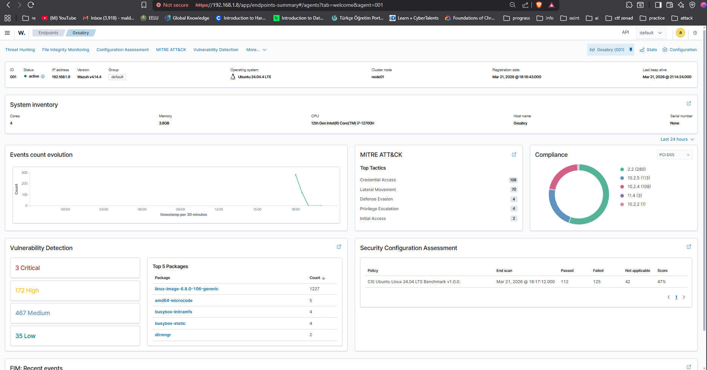<br /><sub><strong>01 · Endpoint visibility</strong><br />Wazuh dashboard confirming the monitored Ubuntu agent is active.</sub></td>
    <td width="50%" align="center">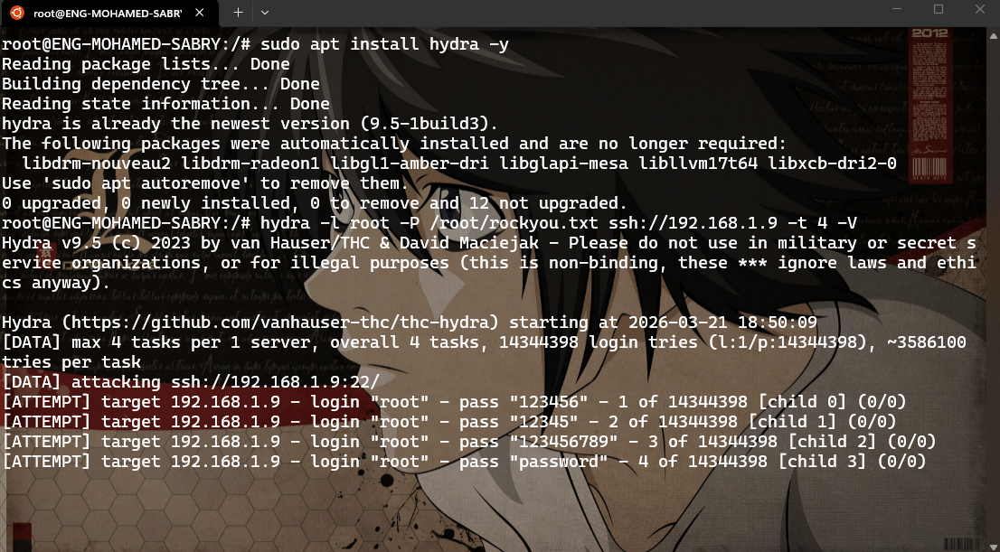<br /><sub><strong>02 · SSH attack simulation</strong><br />Hydra running a controlled dictionary-based SSH test from WSL.</sub></td>
  </tr>
  <tr>
    <td align="center">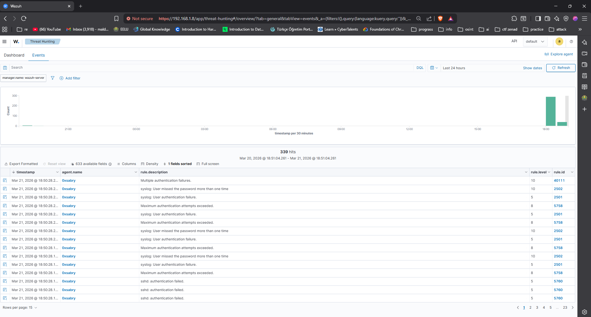<br /><sub><strong>03 · Brute-force detection</strong><br />Wazuh Threat Hunting view with 339 SSH-related events.</sub></td>
    <td align="center">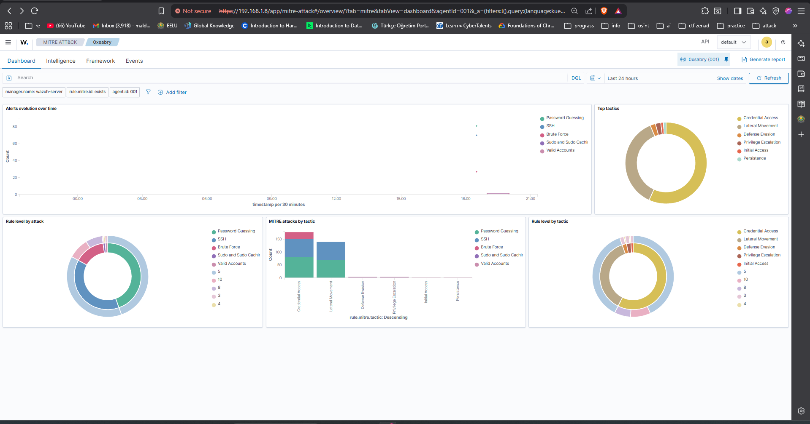<br /><sub><strong>04 · ATT&CK overview</strong><br />Wazuh tactic and technique coverage across detected activity.</sub></td>
  </tr>
  <tr>
    <td align="center">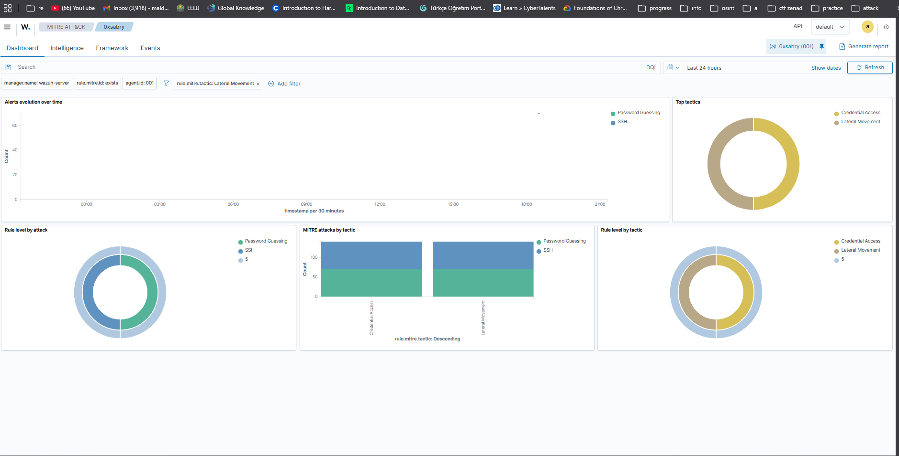<br /><sub><strong>05 · Lateral movement analysis</strong><br />ATT&CK dashboard filtered to SSH-related lateral movement behavior.</sub></td>
    <td align="center">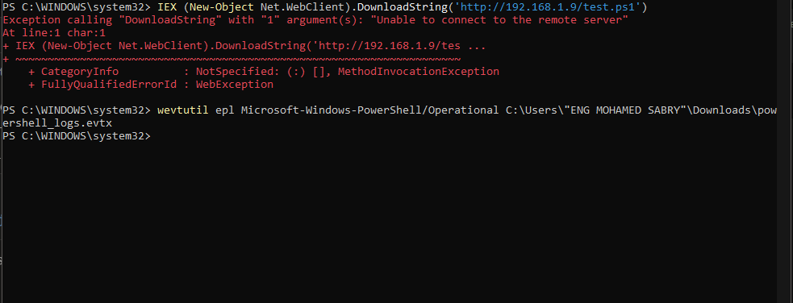<br /><sub><strong>06 · PowerShell simulation</strong><br />Controlled IEX download-cradle attempt and Event Log export.</sub></td>
  </tr>
  <tr>
    <td align="center">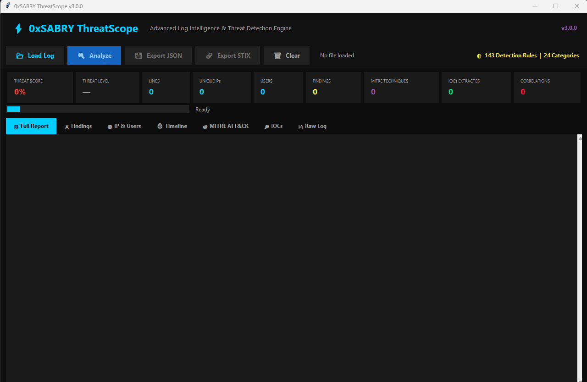<br /><sub><strong>07 · ThreatScope readiness</strong><br />Custom analysis tool with its detection rules loaded.</sub></td>
    <td align="center">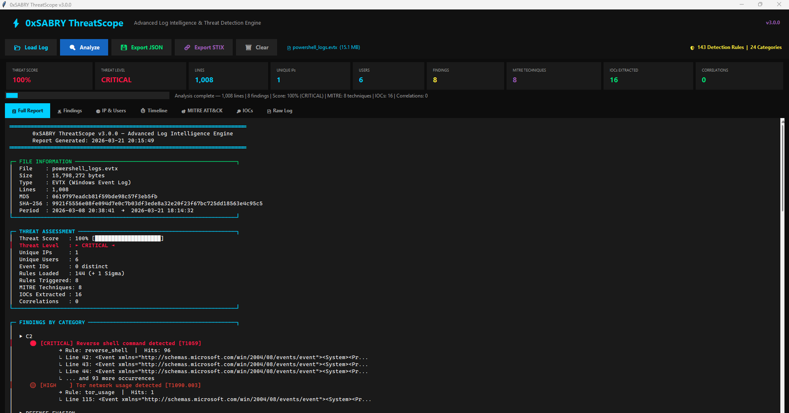<br /><sub><strong>08 · Critical PowerShell analysis</strong><br />ThreatScope report for 1,008 PowerShell log lines.</sub></td>
  </tr>
  <tr>
    <td align="center">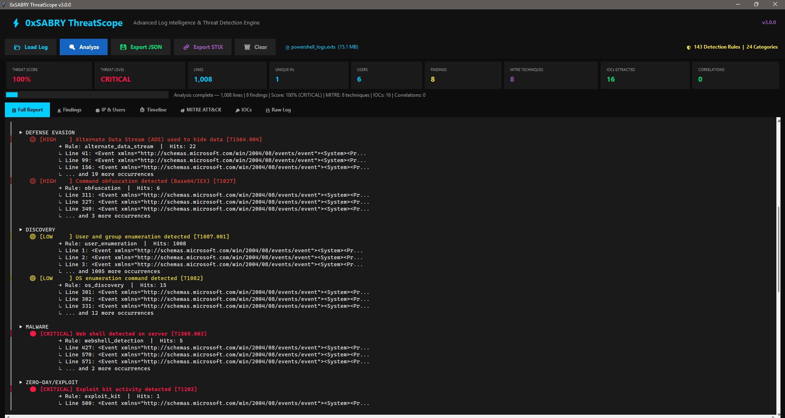<br /><sub><strong>09 · Findings by category</strong><br />Defense evasion, discovery, malware, and exploit detections.</sub></td>
    <td align="center">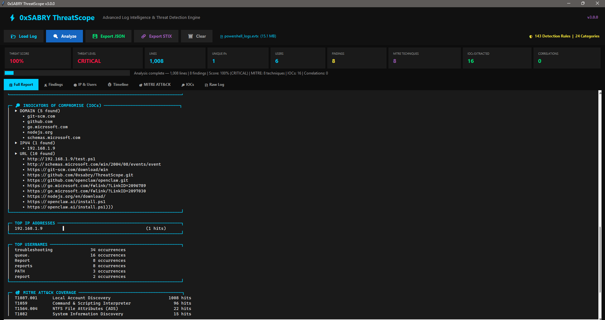<br /><sub><strong>10 · IOC enrichment</strong><br />Extracted indicators paired with ATT&CK technique coverage.</sub></td>
  </tr>
  <tr>
    <td align="center">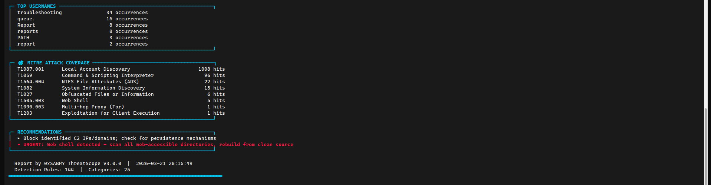<br /><sub><strong>11 · Response recommendations</strong><br />ThreatScope remediation guidance and report summary.</sub></td>
    <td align="center">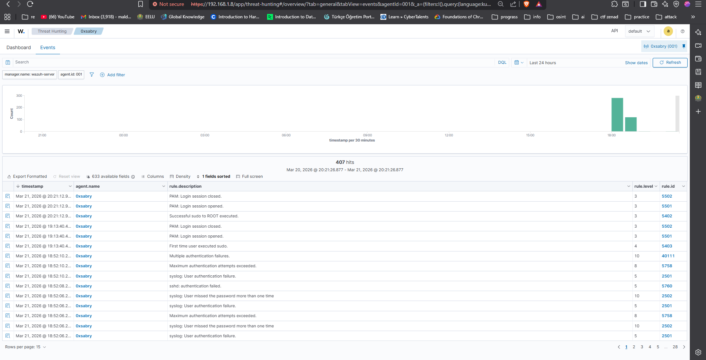<br /><sub><strong>12 · Privilege-escalation detection</strong><br />Wazuh events showing sudo-to-root and PAM activity.</sub></td>
  </tr>
  <tr>
    <td align="center">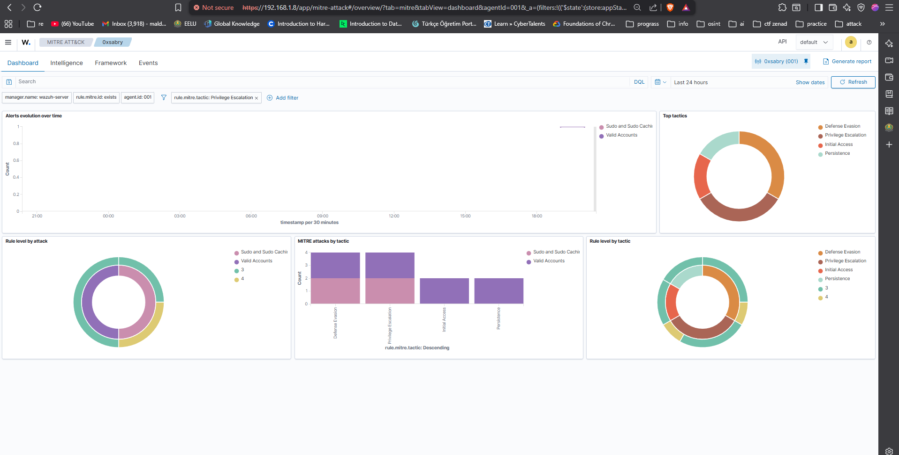<br /><sub><strong>13 · Privilege-escalation mapping</strong><br />ATT&CK view focused on sudo and valid-account activity.</sub></td>
    <td align="center">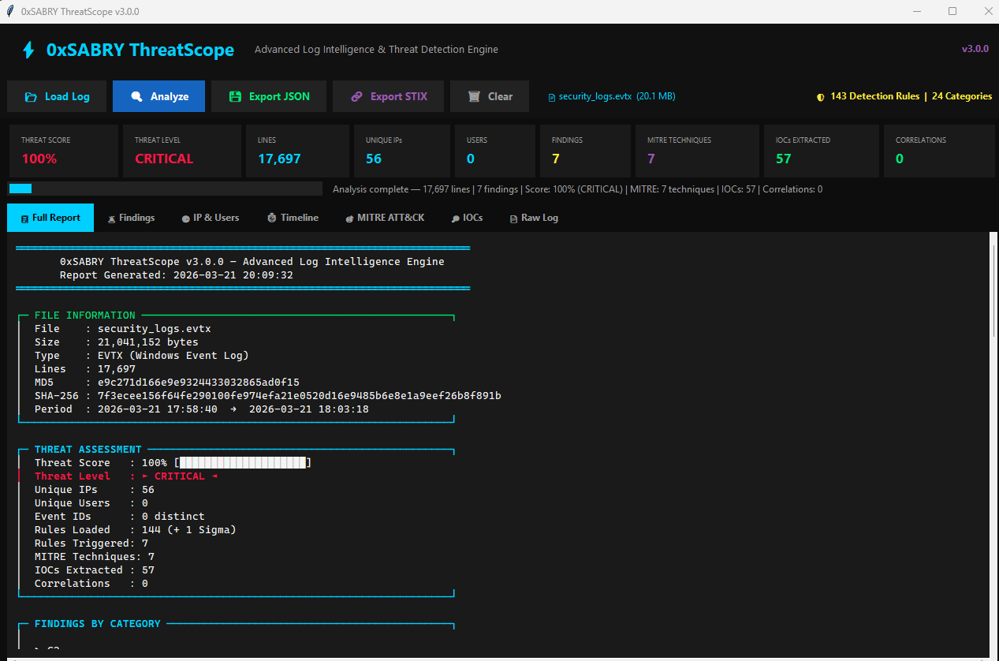<br /><sub><strong>14 · Full log-analysis report</strong><br />ThreatScope summary for a 17,697-record security-log analysis (security_logs.evtx, 21 MB; the count is reported as "lines" by ThreatScope v3.0.0).</sub></td>
  </tr>
</table>

For the complete walkthrough, metrics, alert details, screenshots, and incident-response recommendations, view the **[Live Interactive Web Report](https://0xsabry.github.io/soc-lab-project/)**, open **[SOC_Lab_Project_0xSABRY.html](SOC_Lab_Project_0xSABRY.html)**, or see the included PDF report.

## Related Cybersecurity Portfolio Projects

| Project | Focus Area | Repository & Live Report |
| --- | --- | --- |
| **SOC Lab — Automated Threat Detection** | SIEM (Wazuh), ATT&CK, Threat Detection | [🌐 Live Web Report](https://0xsabry.github.io/soc-lab-project/) · [🐙 Repository](https://github.com/0xsabry/soc-lab-project) |
| **Metasploitable 2 Penetration Test** | Pentesting, GVM, Root Exploitation | [🌐 Live Pentest Report](https://0xsabry.github.io/metasploitable2-penetration-test/) · [🐙 Repository](https://github.com/0xsabry/metasploitable2-penetration-test) |

## Project Assets

```text
.
├── index.html                             # Live SOC Lab Web Report
├── SOC_Lab_Project_0xSABRY.html           # Interactive SOC report source
├── SOC_Lab_Project_0xSABRY.pdf            # SOC Lab portable report
├── SOC_Lab_Project_0xSABRY.docx           # Editable report source
├── images/                                # Complete SOC evidence gallery
└── soc-lab-project-0xSABRY.zip            # Packaged project archive
```

## Safe Use

This repository contains documentation and evidence from an authorized, isolated cybersecurity lab. It is intended for defensive education, security analysis, and portfolio review only. Do not use attack techniques or tools against systems without explicit permission.

## Author

**Mohamed Sabry Hamdan** · Cybersecurity Analyst | SOC | Incident Response | DFIR | Detection<br>
GitHub: [@0xsabry](https://github.com/0xsabry)

---

<p align="center">Built as a cybersecurity portfolio project · March 2026</p>
